# ResuMate — local job application assistant

> Paste a job description, get a tailored skills matrix, cover letter, three
> email drafts, and an ATS summary — generated by a small LLM running on your
> own machine. No paid APIs. No cloud inference.

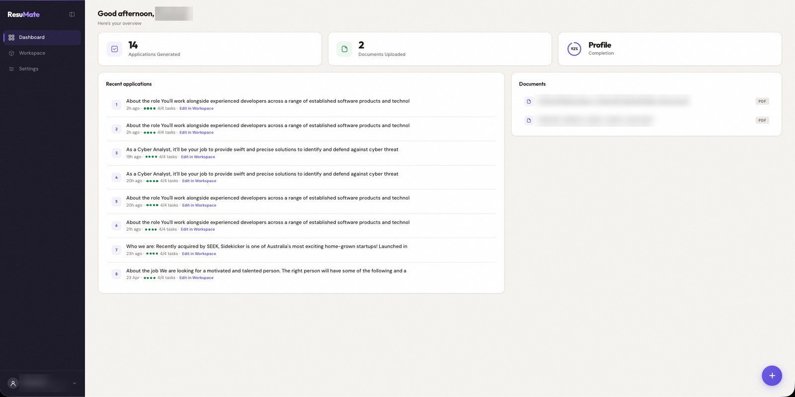

---

## What it does

ResuMate reads your resume documents, analyses a job description, retrieves the
evidence from your experience that matches it, and writes an application
package:

| Output         | What you get                                                              |
| -------------- | ------------------------------------------------------------------------- |
| Skills matrix  | JD requirements mapped to evidence from your resume, plus gaps            |
| Cover letter   | Short letter built from your two most relevant achievements               |
| Emails         | Three drafts — Application, Cold outreach, Follow-up — each editable      |
| ATS summary    | Keyword-aligned summary for applicant tracking systems                    |

Every claim is checked against your evidence before it is shown: numbers and
tools that don't appear in your resume are rewritten or dropped.

**What stays local:** all LLM inference (Ollama), embeddings, the vector store,
your documents and generated applications.
**What touches the network:** Google sign-in, Gmail send and Drive upload (only
if you configure Google OAuth), Google Fonts on the web pages, and a one-time
download of the embedding model from Hugging Face.

---

## Screenshots

### Web app

| Dashboard | Quick actions |
| --- | --- |
|  | 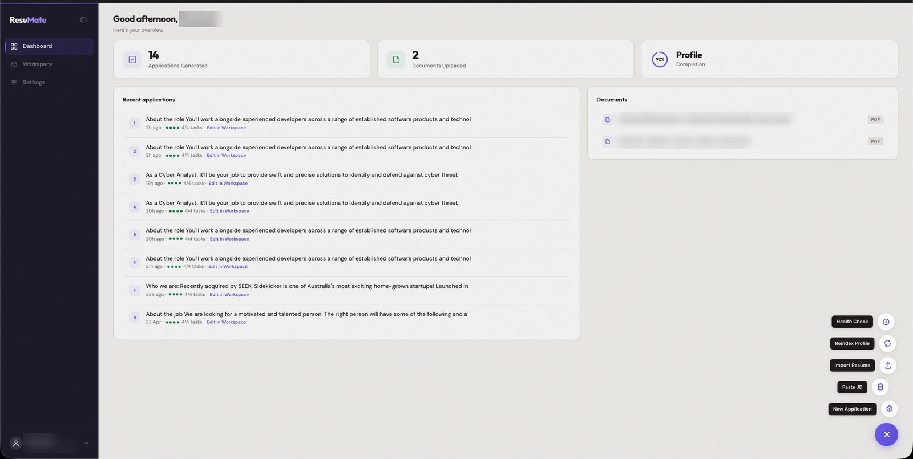 |

| Workspace — cover letter | Workspace — emails |
| --- | --- |
| 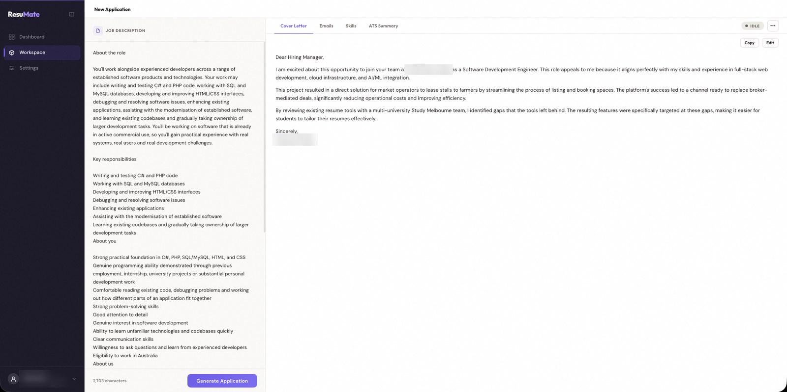 | 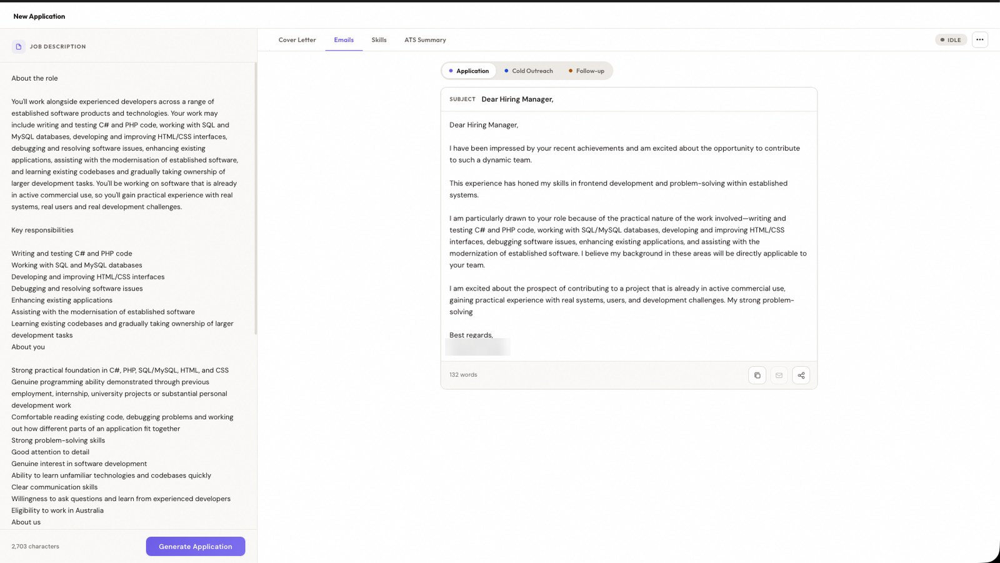 |

| Settings — Profile | Settings — Model | Settings — About |
| --- | --- | --- |
| 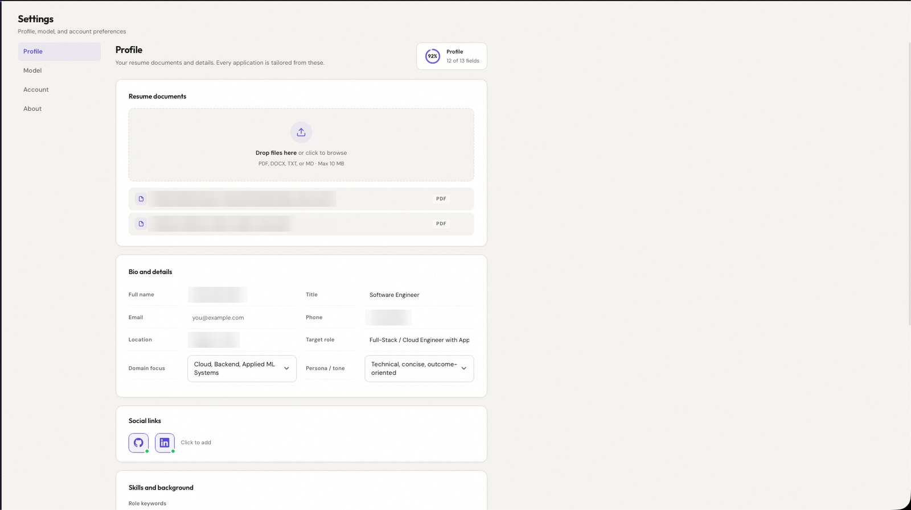 | 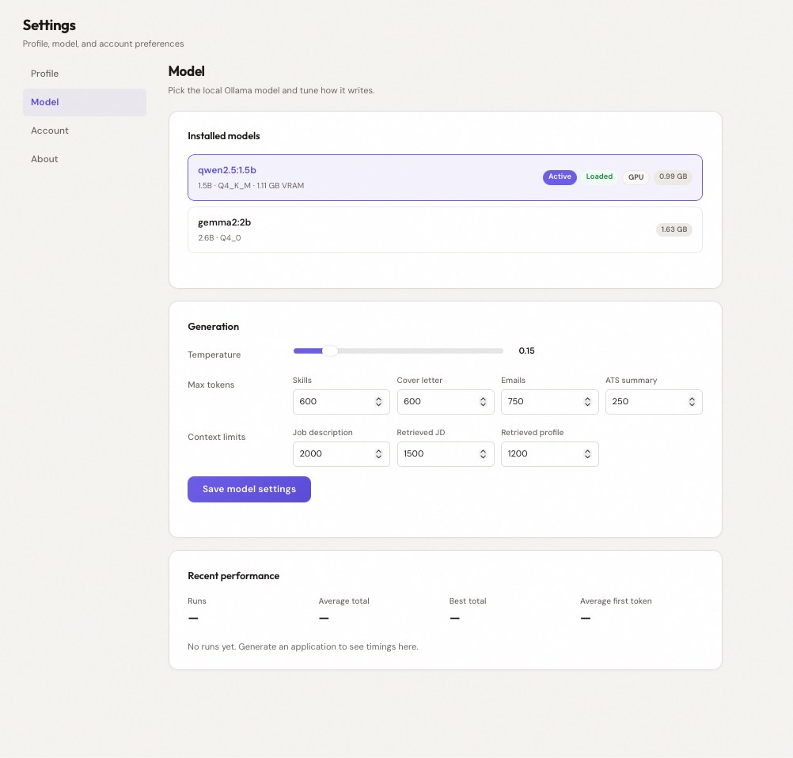 | 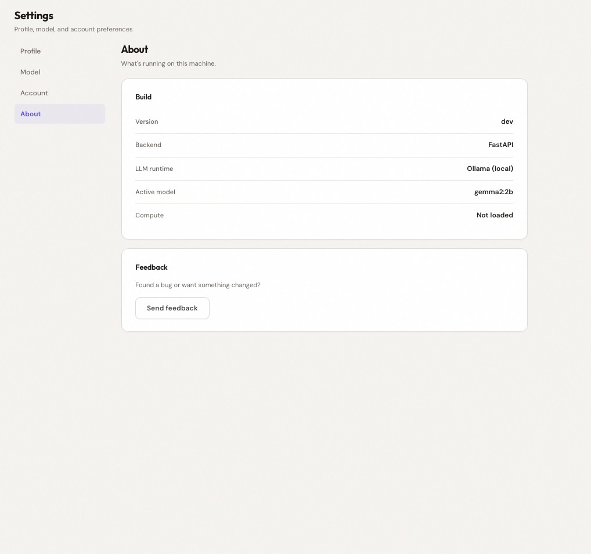 |

### Landing page and sign-in

| Hero | Features | How it works |
| --- | --- | --- |
| 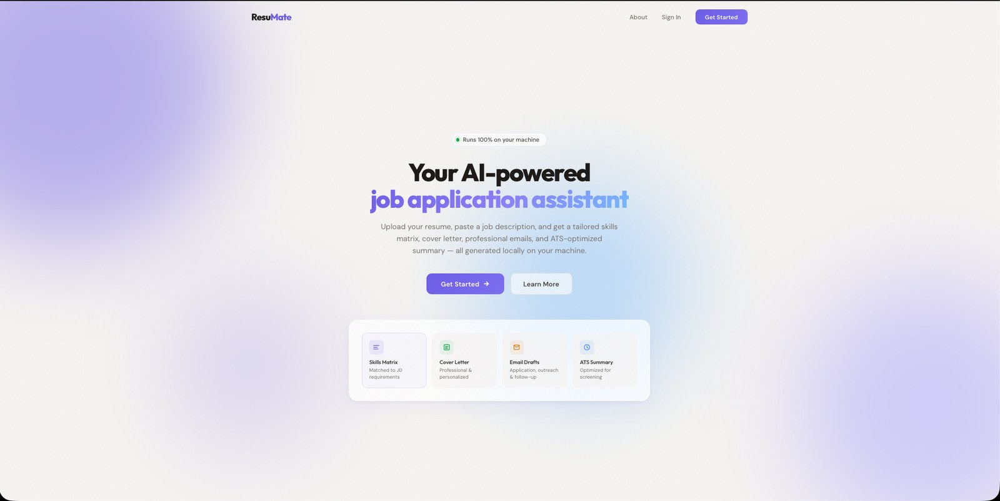 | 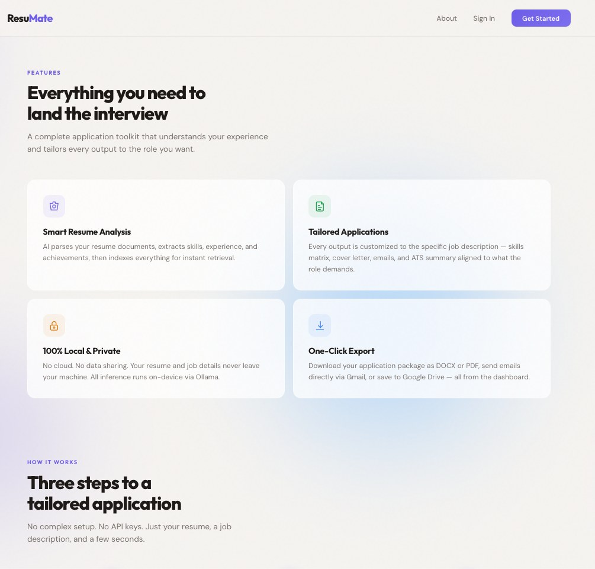 | 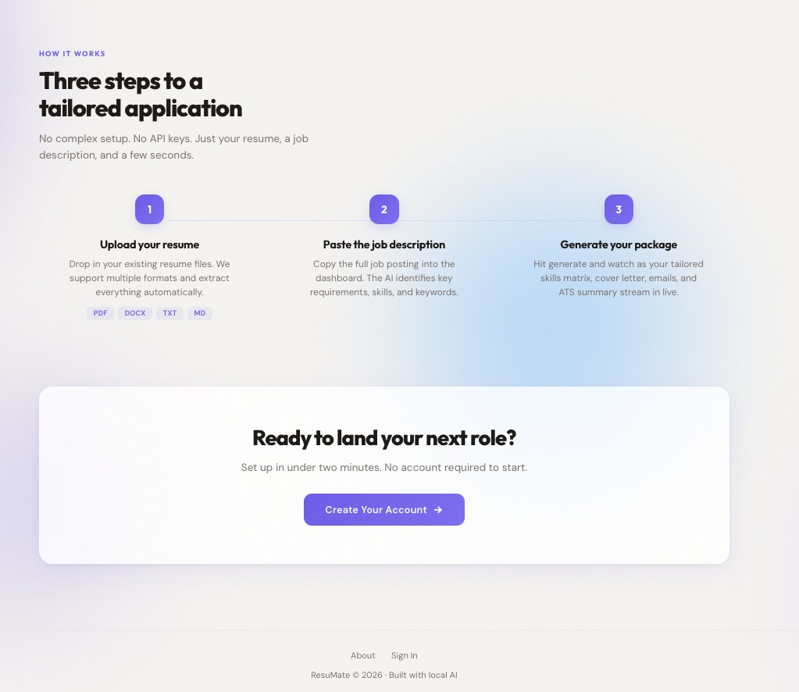 |

| Sign up | Sign in with Google |
| --- | --- |
| 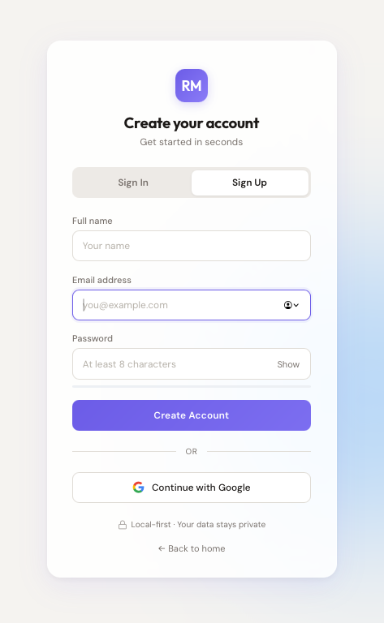 | 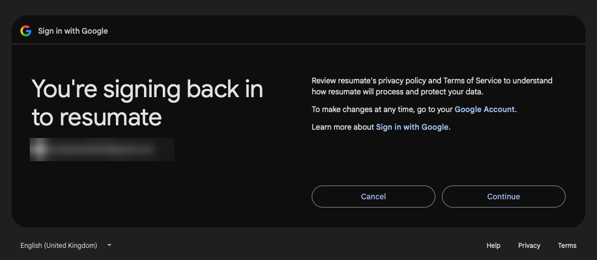 |

### Terminal dashboard (`./dev.sh`)

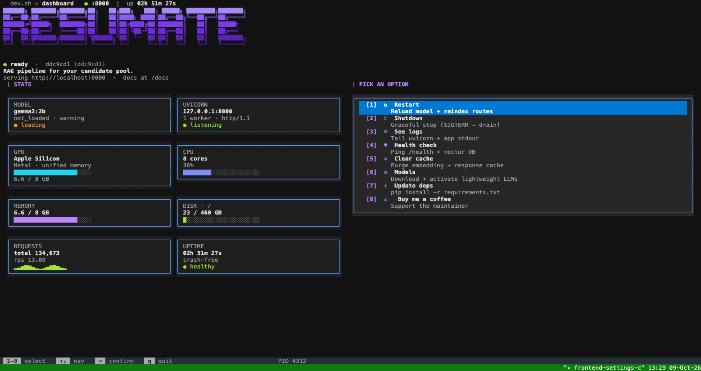

| Health check | Model manager |
| --- | --- |
| 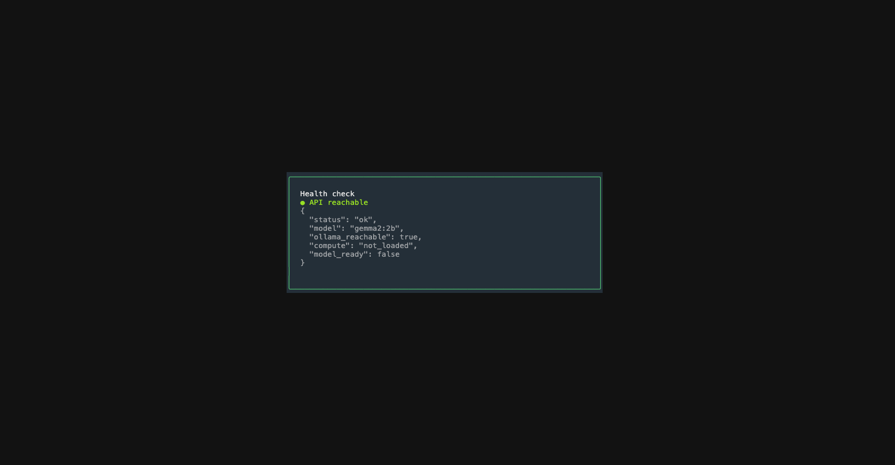 | 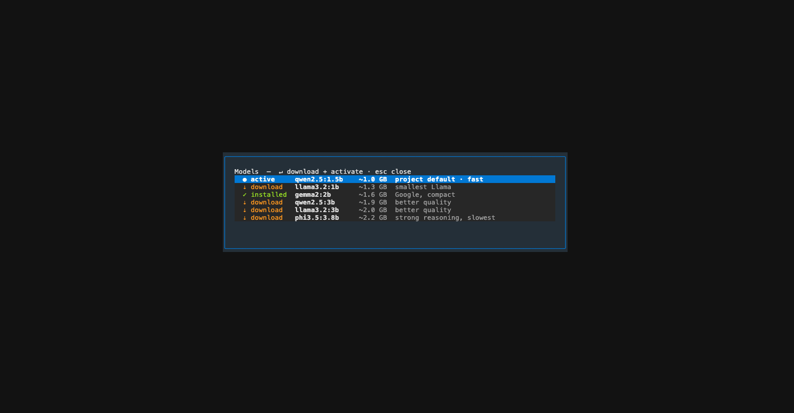 |

---

## Stack

| Layer            | Tool                                         | Version (requirements.txt) |
| ---------------- | -------------------------------------------- | -------------------------- |
| Language         | Python                                       | 3.10+                      |
| API              | FastAPI + Uvicorn (SSE streaming)            | 0.121.0 / 0.38.0           |
| LLM runtime      | Ollama — default model `qwen2.5:1.5b`        | `ollama` client 0.6.0      |
| Embeddings       | `all-MiniLM-L6-v2` via sentence-transformers | 3.1.1 (PyTorch 2.4.1)      |
| Vector store     | Chroma (telemetry off)                       | 0.4.22                     |
| Orchestration    | LangChain (embeddings + Chroma wrappers)     | 0.3.x                      |
| Documents        | pypdf · python-docx · reportlab              | 5.0.1 · 1.2.0 · ≥4.0       |
| Text matching    | rapidfuzz                                    | 3.9.7                      |
| Auth             | python-jose (JWT cookie) · Google OAuth      | 3.5.0                      |
| Frontend         | Vanilla HTML/CSS/JS, no build step           | —                          |
| Dev dashboard    | Textual + Rich + psutil + pyfiglet           | textual 8.2.4              |

---

## Quick start

### Prerequisites

- macOS or Linux with Python 3.10+
- [Ollama](https://ollama.com/download)
- Homebrew `bash` 4+ (macOS) — `dev.sh` uses associative arrays
- `watchfiles` on your `PATH` (`pip install watchfiles`)

### 1. Install

```bash
git clone https://github.com/Only-Bugs/rag-job-assistant.git
cd rag-job-assistant
python3.10 -m venv sandbox
sandbox/bin/python -m pip install -r requirements.txt
ollama pull qwen2.5:1.5b
cp .env.example .env        # optional: Google OAuth, secrets
```

### 2. Run

```bash
./dev.sh
```

`dev.sh` takes no arguments. It:

1. Attaches to a running Ollama on `:11434`, or starts `ollama serve` (logs to `logs/ollama.log`).
2. Starts the API: `uvicorn resumate.app:app --reload` on `:8000` with `PYTHONPATH=src` (logs to `logs/uvicorn.log`) and opens your browser — set `DEV_OPEN_BROWSER=0` to skip.
3. Warms the configured model, then runs two background guards: a readiness watchdog (restarts Ollama if the model isn't ready within 60 s) and a RAM guard (restarts Ollama above 12 GB RSS).
4. Opens the terminal dashboard. Quitting it shuts everything down — Ollama only if `dev.sh` started it.

**Without `dev.sh`:**

```bash
OLLAMA_KEEP_ALIVE=24h ollama serve &
PYTHONPATH=src sandbox/bin/uvicorn resumate.app:app --port 8000
```

Then open <http://localhost:8000>, create an account (email + password, or
Google if configured), and upload your resume.

---

## Terminal dashboard

`scripts/dev_tui.py` (Textual) polls `GET /health` every 1.5 s.

**Stat cards:** Model (name, compute, readiness) · Uvicorn (listening) · GPU
(Apple Silicon unified memory) · CPU · Memory · Disk · Requests · Uptime.

**Actions** — press the number, or `q` to quit:

| Key | Action         | What it does                                                                                 |
| --- | -------------- | -------------------------------------------------------------------------------------------- |
| 1   | Restart        | Sends SIGTERM to the API on :8000 (see Known issues — it does not come back on its own)      |
| 2   | Shutdown       | Confirms, then exits; `dev.sh` stops the API and Ollama                                      |
| 3   | See logs       | Last 200 lines of `logs/uvicorn.log`                                                         |
| 4   | Health check   | Shows `/health` and `/api/stats` JSON                                                        |
| 5   | Clear cache    | Placeholder — not wired yet                                                                  |
| 6   | Models         | Catalog of 6 small models; ⏎ pulls with a progress bar, activates it, and hot-reloads the API |
| 7   | Update deps    | Placeholder — prints the pip command to run                                                  |
| 8   | Buy me a coffee | Opens buymeacoffee.com                                                                      |

---

## Web app

**Dashboard (`/`)** — application count, documents, profile completion, recent
applications (open any one in the Workspace), and a quick-action button for New
application, Paste JD, Import resume, Reindex profile and Health check.

**Workspace (`/workspace`)** — paste a JD and press Generate. Results stream
into four tabs (Cover letter, Emails, Skills, ATS summary) and are saved
automatically.
- Status pill shows idle / thinking / ready / error with elapsed time.
- ⋯ menu: download PDF or DOCX, reindex profile, stop generating.
- Cover letter, skills and ATS tabs: Copy and Edit in place.
- Emails: switch between Application, Cold outreach and Follow-up; edit subject
  and body; copy, share, or send via Gmail (when Google is connected).

**Settings (`/settings`)** — one page with a section menu; each section has its
own link (`/settings#model`).
- **Profile** — upload/delete resume documents (PDF, DOCX, TXT, MD; re-indexed on
  upload), bio fields, GitHub/LinkedIn links, role keywords, skills,
  achievements, pitch, and a completion meter.
- **Model** — installed Ollama models (click to switch), temperature, per-task
  token limits, context limits, and recent generation timings.
- **Account** — account details, export all your data as a zip, delete account.
- **About** — version, active model, compute, feedback link.

**Onboarding (`/onboarding`)** — upload a resume and the LLM extracts your
profile fields for you to confirm.

**Auth** — email + password (PBKDF2) is always available; Google sign-in appears
when `GOOGLE_CLIENT_ID` and `GOOGLE_CLIENT_SECRET` are set. Sessions are a
30-day HS256 JWT in an httpOnly cookie. Each user's documents, vector store and
applications live under `data/users/<user_id>/`.

---

## Configuration

**Environment variables** (`.env` at the project root):

| Variable               | Default                                | Purpose                                  |
| ---------------------- | -------------------------------------- | ---------------------------------------- |
| `OLLAMA_HOST`          | `http://localhost:11434`               | Ollama endpoint                          |
| `LLM_MODEL`            | `model_config.yaml` → `llm.model_name` | Override the model at startup            |
| `LLM_NUM_CTX`          | `4096`                                 | Context window sent with every call      |
| `GOOGLE_CLIENT_ID`     | empty                                  | Enables Google sign-in, Gmail and Drive  |
| `GOOGLE_CLIENT_SECRET` | empty                                  |                                          |
| `AUTH_REDIRECT_URI`    | `http://localhost:8000/auth/callback`  | Must match your Google OAuth client      |
| `JWT_SECRET`           | generated into `data/.jwt_secret`      | Signs session cookies                    |
| `SESSION_SECRET`       | `JWT_SECRET`                           | Signs the OAuth state session            |
| `CORS_ORIGINS`         | `*`                                    | Comma-separated allowed origins          |
| `DEV_OPEN_BROWSER`     | `1`                                    | `dev.sh`: open the browser on start      |

**Config files** (`src/resumate/config/`):
- `model_config.yaml` — model name, host, temperatures, per-task `num_predict`, context limits, embedding model. Written by Settings › Model and the TUI model manager.
- `settings.yaml` — data paths, chunking (`chunk_size` 800, `chunk_overlap` 200, `top_k` 5).

---

## API

| Method   | Path                          | Purpose                                              |
| -------- | ----------------------------- | ---------------------------------------------------- |
| `GET`    | `/health`                     | API status, model, Ollama reachability, compute      |
| `POST`   | `/generate`                   | Stream an application package (SSE)                  |
| `POST`   | `/generate/cancel`            | Stop an in-flight generation                         |
| `GET/POST` | `/profile`                  | Read / save profile fields                           |
| `POST`   | `/profile/reindex`            | Rebuild the profile index                            |
| `POST`   | `/upload` · `/ingest`         | Upload a document · index documents                  |
| `GET`    | `/documents`                  | List documents                                       |
| `DELETE` | `/documents/{filename}`       | Delete a document                                    |
| `POST`   | `/tools/parse-resume`         | Extract profile fields from a resume (LLM)           |
| `POST`   | `/export/pdf` · `/export/docx` | Export a package                                    |
| `GET/POST` | `/api/applications`         | List / save applications                             |
| `GET/DELETE` | `/api/applications/{id}`  | Open / delete an application                         |
| `GET`    | `/api/models`                 | Installed models with active/loaded/compute flags    |
| `POST`   | `/api/models/select`          | Switch model and save tunables                       |
| `POST`   | `/api/models/reload`          | Hot-reload the model (localhost only; used by TUI)   |
| `GET`    | `/api/models/config`          | Current tunables                                     |
| `GET`    | `/api/stats`                  | Recent generation timings                            |
| `GET/POST` | `/api/gmail/status` · `/api/gmail/send` | Gmail integration                        |
| `GET/POST` | `/api/drive/status` · `/api/drive/upload` | Drive integration                      |
| —        | `/auth/*`                     | `register`, `signin`, `login`/`callback` (Google), `logout`, `me`, `export-data`, `DELETE account` |

**`POST /generate`** takes `{"job_description": "..."}` and streams SSE events:
`stream` (request id), `status`, `progress`, `token` (live text per task),
`task` (`{"task": "skills"|"cover"|"emails"|"ats", "content": "..."}`),
`blocked` (JD is out of domain for your profile), `cancelled`, `error`.

```bash
curl -s localhost:8000/health | python -m json.tool
```

---

## Project structure

```
src/
├── resumate/                 # FastAPI app — entrypoint resumate.app:app
│   ├── routes/               # auth, generate, profile, documents, models, applications,
│   │                         # export, tools, gmail, drive, health, pages
│   ├── services/             # analysis, evidence, retrieval, jd_sections, tasks,
│   │                         # validate, generation, ingestion, resume_parser, profile
│   ├── models/               # llm.py (Ollama client), embeddings.py, vectorstore.py (Chroma)
│   ├── prompts/              # templates.py
│   ├── evaluation/           # checks.py — deterministic output checks
│   ├── middleware/           # auth.py — JWT, password hashing, user store
│   ├── config/               # settings.py, model_config.yaml, settings.yaml
│   └── utils/
└── frontend/
    ├── pages/                # landing, login, onboarding, index (dashboard),
    │                         # workspace, settings, about, 404
    └── shared/               # styles.css, common.js
scripts/                      # dev_tui.py, eval_prompts.py, benchmarks
tests/                        # pytest suite + eval fixtures
data/users/<id>/              # per-user documents, Chroma DB, applications (git-ignored)
logs/                         # uvicorn.log, ollama.log, app.log, performance.json
docs/screenshots/             # images used in this README
```

---

## Development

```bash
sandbox/bin/python -m pytest tests                                 # unit + API tests
sandbox/bin/python scripts/eval_prompts.py --label baseline        # run the prompt eval (needs Ollama)
sandbox/bin/python scripts/eval_prompts.py --compare eval_runs/A eval_runs/B
sandbox/bin/python scripts/benchmark_runtime.py                    # stage timings from logs/runtime.log
sandbox/bin/python scripts/analyze_performance.py                  # TTFT / latency from logs/performance.json
```

The eval harness runs all four tasks over the fixture JDs in
`tests/fixtures/eval/` and writes outputs, check results and a summary to
`eval_runs/<timestamp>/`.

---

## Known issues

Snapshot as of October 2026. Each item: what you see → where it comes from.

### UI

- **Recent applications show raw JD text and duplicates.** Rows read "About the role You'll work…" instead of company and role, and generating twice for the same JD adds a second row. → `routes/applications.py:42` stores `jd_text[:120]`; no dedupe; role/company never reach the client (see RAG).
- **No navigation on narrow screens.** Below 860 px the sidebar is hidden with no replacement. → `shared/styles.css` `@media (max-width: 860px)`.
- **"Connect Gmail in Settings" points nowhere.** Settings has no Gmail control. → `workspace.html:1238, 1248`.
- **Landing page over-promises.** "No account required to start" (every app page needs sign-in) and "save to Google Drive … from the dashboard" (Drive save was removed from the UI). → `landing.html:819, 861`.
- **Social links hint always says "Click to add"**, even when both links are set. → `settings.html` `.link-icons-hint`.
- **Profile Email field starts empty** even though the account email is known.
- **Workspace header always says "New Application"**, including when editing a saved one.
- **Workspace still uses all-caps eyebrow labels** ("JOB DESCRIPTION", "SUBJECT") that the dashboard and settings have dropped.
- **Settings › Model controls mostly don't affect generation** — see RAG below.

### RAG / generation

- **Email subject can be the greeting** ("Dear Hiring Manager,"). The model sometimes skips the subject line and the fallback only triggers on empty, ungrounded-number or >14-word subjects. → `services/tasks.py` `_split_email`, `run_emails`.
- **Email bodies stop mid-sentence.** Hard-coded `_EMAIL_PREDICT = {1: 220, 2: 150, 3: 150}` overrides the 750 in `model_config.yaml`, and nothing trims back to the last full sentence. → `services/tasks.py:170`.
- **Role is taken from the JD's first line.** JDs starting "About the role" / "About the job" produce subjects like "Application: About the role", and with no company found the model may insert one from your own resume. → `services/jd_sections.py:85-98`.
- **Cover letter can open a paragraph with a dangling "This project…"** after the validator drops the sentence that introduced it. → `services/tasks.py` `run_cover` → `drop_unsupported`.
- **Evidence choice is loosely tied to the JD.** Pairs are accepted at ~0.32 cosine; with no pairs the cover falls back to the first two resume items rather than the best two; outreach email picks the item with most metrics regardless of relevance. → `services/analysis.py:190, 216`, `services/tasks.py:144, 173`.
- **Evidence ids and raw name casing leak into emails** (e.g. "(E7)", "I'm FULL NAME") — `clean_prose` doesn't strip them. → `services/validate.py:74-89`.
- **Settings › Model tunables are mostly ignored.** Temperature is read at import time; per-task `num_predict` shadows `max_tokens`; retrieved-context limits and `top_k` are never read. → `models/llm.py:84`, `config/settings.py`, `services/jd_sections.py:105`.
- **JD retrieval filters by `doc_type` after the search**, so a profile-heavy top-24 can return no JD chunks. → `services/retrieval.py:29-32`.

### FastAPI / backend

- **`/health` reports a stale model.** It uses `MODEL_NAME` read once at import; switching models only updates `llm.LLM_MODEL`. Settings › About and the TUI then show the old model as "not loaded", and `model_ready` stays false — which can make `dev.sh`'s watchdog restart Ollama every 60 s. → `routes/health.py:10, 29, 55`, `models/llm.py:273`.
- **"Recent performance" is always empty.** `/api/stats` expects task names `gen_skills|gen_cover|gen_emails|gen_ats`, but generation now logs sub-calls like `gen_ats:outcome1`. → `routes/models.py:168-206`.
- **Closing the tab doesn't stop generation.** The SSE handler never checks for disconnect, so the worker keeps calling Ollama; `/generate/cancel` has no ownership check. → `routes/generate.py:54-73, 104-147`.
- **Generation metadata is dropped.** Role, company and validation flags (`_meta`) are computed but never sent to the client. → `routes/generate.py:111-120`.
- **`/api/models/select` rewrites `model_config.yaml` lossily** — comments and keys like `max_tokens.default` are lost. → `routes/models.py:101-111` (TUI does the same at `scripts/dev_tui.py:350`).
- **`/api/models/reload` accepts any model name** and is reachable cross-origin because CORS defaults to `*`. → `routes/models.py:135-153`, `app.py:126`.
- **OAuth session secret falls back to a hard-coded `"dev-session-secret"`** when neither `SESSION_SECRET` nor `JWT_SECRET` is in the environment (the generated `data/.jwt_secret` isn't used). → `app.py:122`.
- **Exports block the event loop** — PDF/DOCX are built synchronously inside `async` handlers. → `routes/export.py:134-151`.
- **Model warm-ups omit `num_ctx`**, so the first real call can force Ollama to reload the model. → `routes/models.py:121, 144`, `dev.sh:163`.
- **Tests write into the real `logs/app.log`** because importing `app.py` attaches a file handler.
- **`.env.example` says leaving Google blank runs "no login required"** — pages still require signing in (email/password works).

### Dev tooling

- **TUI Restart kills the API and nothing restarts it.** → `scripts/dev_tui.py:600-606`.
- **TUI Requests card isn't live traffic.** It counts every request line in the append-only `uvicorn.log` across all sessions (mostly its own `/health` polls) and divides by TUI uptime; the sparkline, "crash-free" and "healthy" are hard-coded; the GPU bar shows system RAM. → `scripts/dev_tui.py:76-88, 172-213`.
- **Clear cache and Update deps are placeholders.** ⏎ on a highlighted menu row may do nothing — use the number keys.
- **`dev.sh` still requires `watchfiles`** though it no longer uses it, carries an unused bash dashboard, and hard-codes `#!/opt/homebrew/bin/bash`.
- **`.gitignore` negations are broken** — `!README.md  # keep…` lines include the comment in the pattern, so new `*.md` files (including under `docs/`) are ignored.
- **Runtime files are tracked** (`logs/performance.json`, `data/job_rag/.*_index_state.json`) and large untracked logs (`logs/dev_sh.out`) aren't ignored.
- **`.env.example` lists variables nothing reads** (`LOG_LEVEL`, `LLM_PARALLEL_WORKERS_OVERRIDE`, `RAG_LLM_PARALLEL_WORKERS`); `fpdf` is pinned but unused.

---

## Roadmap

**Next**
- Fix the model-state and `/api/stats` bugs above; make Settings › Model tunables take effect.
- Recent applications: parsed company · role titles, versioning instead of duplicates.
- Mobile navigation.
- Gmail connect in Settings; restore Drive save.

**Later**
- Docker setup with an Ollama sidecar.
- CI (tests + eval smoke run).

**Done recently**
- Decomposed, validated generation with evidence ids and deterministic JD analysis.
- Single Settings page (Profile · Model · Account · About); one account menu.
- Terminal dashboard with model manager.
- Email type switcher with editable compose card; generation cancel.
- Per-user data, email/password + Google auth.

---

## Rules for contributors

- No cloud LLM APIs — inference stays on Ollama.
- Chroma telemetry stays disabled.
- Never modify users' uploaded resume files programmatically; ingestion is read-only.
- Python 3.10 minimum.

## License

MIT — see [LICENSE](LICENSE).
